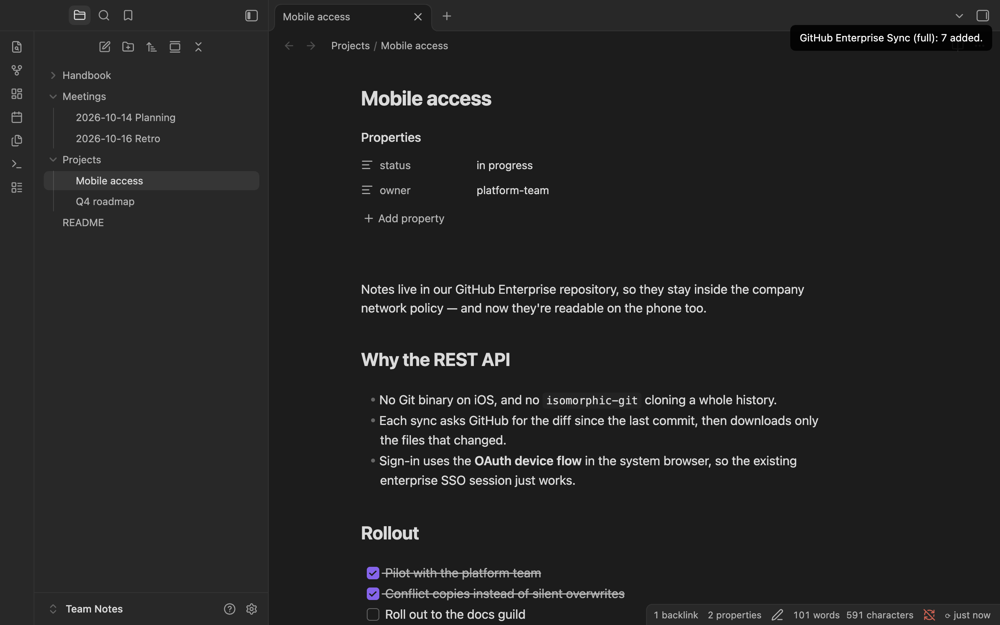
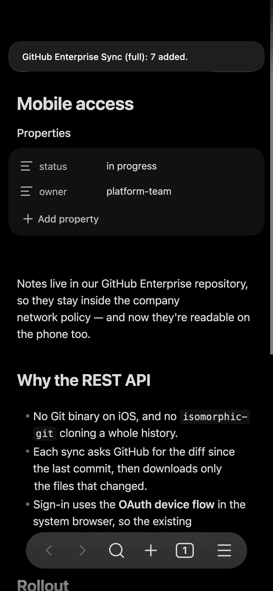
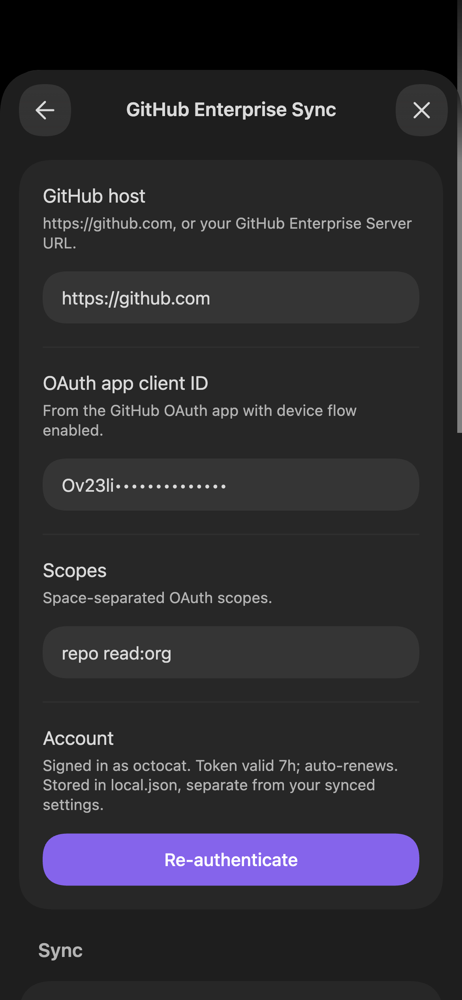
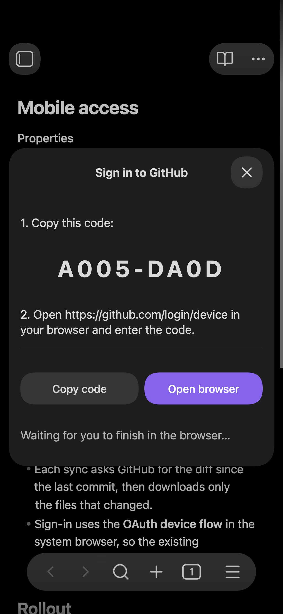

# GitHub Enterprise Sync

An Obsidian plugin that syncs notes with a GitHub repository — including GitHub
Enterprise Server — over the **GitHub REST API**. There is no Git
implementation in JavaScript and no native code, so it works on mobile,
including Obsidian on iOS.

Status: **early**. Sync is bi-directional: it pulls changes from GitHub and
pushes local edits back as ordinary commits, with incremental updates,
integrity verification, conflict copies, and automatic syncing.



| Phone | Settings | Sign-in |
| --- | --- | --- |
|  |  |  |

## Why this exists

Obsidian's own sync isn't always an option — some notes live in repositories
that can't leave a particular GitHub instance. The existing Git plugins shell
out to a real Git binary or bundle `isomorphic-git`, neither of which is a good
fit on iOS. This plugin talks to the REST API instead, so the only thing it
needs is HTTPS.

## How it works

### Authentication: OAuth device flow

Obsidian on iOS has no usable redirect target for a normal authorization-code
flow, and embedding a web view to collect SSO credentials is both fragile and a
bad idea. The [device
flow](https://docs.github.com/en/apps/oauth-apps/building-oauth-apps/authorizing-oauth-apps#device-flow)
avoids both: the plugin shows a short code, `window.open` hands the URL to the
**device's own browser** (Safari on iOS), and the plugin polls GitHub until you
finish. Any SSO session already present in that browser is reused.

There is no embedded web view anywhere in this codebase.

If the OAuth app has expiring user tokens enabled, the device flow returns an
access token valid ~8 hours plus a refresh token valid ~6 months. Every API
call goes through `validAccessToken()`, which exchanges the refresh token when
the access token is within five minutes of expiry. GitHub **rotates the refresh
token on each use**, so both halves of the response are persisted together —
dropping the new refresh token would strand the plugin at the next renewal.
Once the refresh token itself lapses, you sign in again. With non-expiring
tokens, `expires_in` is absent and the refresh path is simply never taken.

### Incremental sync

The plugin records the commit SHA it last synced, plus the blob SHA of every
file it wrote. On the next run it asks GitHub to compare that commit against the
branch head and turns the resulting file list into writes and deletes, fetching
only the blobs that actually changed. Renames delete the old path; removals
delete the file.

It falls back to a full tree walk when the comparison can't be trusted:

- the stored base commit no longer exists (force-push, or garbage collected),
- the histories have diverged,
- more than 300 files changed — GitHub silently truncates the file list at that
  point, and a truncated diff would leave the vault quietly incomplete.

Blobs are fetched **by SHA rather than by path**, so a branch that moves
mid-sync can't hand back bytes belonging to a different commit than the one
being applied.

### Pushing local changes

Every sync pulls first, then pushes. Pushing uses the **Git Data API**, which is
how a Git client would build a commit if it spoke HTTP instead of the wire
protocol:

1. each changed file is uploaded as a blob (`POST /git/blobs`, base64, so images
   and PDFs survive intact);
2. one tree is created on top of the current head's tree (`POST /git/trees` with
   `base_tree`), listing only the changed paths — a deletion is an entry with
   `sha: null`;
3. one commit is created pointing at that tree (`POST /git/commits`);
4. the branch is moved to it (`PATCH /git/refs/heads/{branch}` with
   `force: false`).

The whole push is therefore a single ordinary commit that any Git client can
read. `force: false` makes step 4 a compare-and-swap: if another device pushed
in the meantime, GitHub rejects it with 422, the plugin pulls again and retries
rather than overwriting the other device's work.

Local changes are found by hashing the files on disk and comparing against the
blob SHAs recorded at the last sync — no filesystem watching, no timestamps.
Pushing is skipped entirely when the preceding pull didn't fully verify, since
in that state a file missing locally is indistinguishable from a file deleted
locally.

As a further guard, a push that would remove more than 10% of the synced files
is refused with a notice rather than executed. A vault that failed to mount or a
mistyped folder setting looks exactly like "the user deleted everything".

### Conflicts

When a file changed both locally and remotely since the last sync, nothing is
discarded. The remote version takes the canonical path, and your local bytes are
written beside it as

```
My Note (conflict 2026-08-23 14.05 mobile-a3f2).md
```

That copy is a normal vault file, so the next push uploads it too — both
versions then exist on every device, and you resolve the conflict by editing and
deleting, the same way Obsidian Sync handles it. The device label is generated
once per device and kept in `local.json`.

### Integrity verification

After each file is written, it is read back from the vault and hashed as a Git
blob — `SHA1("blob " + byteLength + "\0" + bytes)` — which is exactly the SHA
GitHub already publishes for that blob. Verification therefore costs one local
hash and no extra network request. A mismatch is reported and that file's SHA is
not recorded, so the next sync fetches it again.

The stored commit pointer only advances when every file verified and nothing was
skipped. Otherwise the next sync would compute its diff from a commit the vault
doesn't actually match, and the missing files would never be noticed again.

### What it won't touch

- Files you edited locally since the last sync are never overwritten: the remote
  version lands at the canonical path and yours is preserved as a conflict copy
  (see above). If the copy can't be written, the remote update is skipped
  instead.
- Anything under the vault's config folder (`.obsidian/` by default, or
  wherever you've moved it) is refused in both directions, so a repository
  can't overwrite your plugin configuration — and your configuration, including
  the `local.json` holding your access token, is never pushed. `.trash/` and
  `.git/` are skipped when pushing for the same reason.

## Network use and privacy

This plugin talks to exactly one remote service: **the GitHub instance you
configure** — github.com or your own GitHub Enterprise Server. It needs that
connection to sign you in and to read and write the repository you sync with.

- **Account required.** You need a GitHub (or GitHub Enterprise) account with
  access to the repository, plus a GitHub OAuth app with device flow enabled
  (see [Setup](#setup)).
- **What is sent.** OAuth requests to `<host>/login/device/code` and
  `<host>/login/oauth/access_token`, and GitHub REST API requests to
  `api.github.com` (or `<host>/api/v3`) that read and write the configured
  repository: the files in the synced folder and commit metadata.
- **No telemetry, no third parties.** Nothing is sent anywhere other than the
  GitHub host you configure. There are no analytics, ads, or tracking.
- **Credentials stay on the device.** Tokens are stored in the plugin's
  `local.json` and never synced or committed (see
  [Where state is stored](#where-state-is-stored)).

Signing in opens GitHub's device-authorization page in your system browser. The
plugin never sees your password.

## Setup

Register a GitHub OAuth app with **"Enable Device Flow"** checked (Settings →
Developer settings → OAuth Apps). No callback URL is needed for this flow.

Then in Obsidian: **Settings → GitHub Enterprise Sync**

| Setting | Value |
| --- | --- |
| GitHub host | `https://github.com`, or `https://github.example.com` for Enterprise Server |
| OAuth app client ID | from your OAuth app |
| Scopes | `repo read:org` (default) |
| Repository | `owner/repo` to sync from |
| Branch | empty for the repository's default branch |
| Remote folder | sync only this subfolder of the repo; empty for the whole repo |
| Vault folder | where files land in the vault; empty for the vault root |

Press **Sign in**, copy the code, tap **Open browser**, authorize.

For repositories behind SAML SSO on github.com, you may additionally need to
authorize the OAuth app for the organization from its settings page.

### Automatic sync

- **Sync on startup** — runs shortly after Obsidian finishes loading (deferred
  so it doesn't compete with initial indexing).
- **Periodic sync** — runs on a timer while Obsidian is open, at a configurable
  interval.

Both are full bi-directional syncs, the same as pressing **Sync now**.

Background runs stay quiet unless something changed. Failures, integrity
mismatches, conflicts, and refused pushes always raise a notice.

## Commands

- **Sync now** — pull, then push
- **Full resync (rebuild from scratch)** — ignores stored state and walks the
  whole tree, then pushes as usual
- **Sign in to GitHub (device flow)**
- **Verify GitHub access** — calls `/user`, lists a repo root, reads a file
- **Sign out of GitHub**

## Verifying without Obsidian

```bash
node scripts/device-flow-test.mjs <client_id> owner/repo [https://github.example.com]
```

Runs the identical request sequence from a terminal — useful to confirm the
OAuth app is configured correctly before installing the plugin.

## Tests

`tests/unit/` covers sync planning — the decisions the engine makes about an API
response — with a stub client and no network. It's fast and needs no
configuration:

```bash
npm test
```

## End-to-end tests

`tests/e2e/` exercises the real engine against a real GitHub repository. There
are no mocks: `src/sync.ts` and `src/github.ts` are bundled through esbuild with
`obsidian` aliased to a Node shim, so the code under test is the code that
ships, and every request goes to the live API.

Configuration lives in `.env.e2e`, which is gitignored — it names a repository
the tests will push to and delete from:

```bash
cp .env.e2e.example .env.e2e   # then fill in E2E_REPO and E2E_CLIENT_ID
npm run test:e2e:login         # once, interactively — opens a device code
npm run test:e2e               # thereafter, non-interactive
```

`test:e2e:login` runs the device flow and caches the token in `.e2e-token.json`
(also gitignored, mode 600). Later runs reuse it, refreshing automatically when
it expires; both halves are re-persisted because GitHub rotates refresh tokens.
`test:e2e` never prompts — it fails with instructions if no usable token is
cached, so it stays usable from CI or a non-interactive shell.

**Use a throwaway repository.** The tests commit, force the branch forward, and
delete paths. They confine themselves to a per-run `e2e/<id>/` folder and remove
it afterwards, so parallel runs don't collide, but the token needs `repo` scope
and nothing stops a bug from reaching further.

Covered: first full sync, incremental edit/add/delete, a no-op sync, pushing new
and edited and deleted files, a second device pulling what the first pushed,
concurrent-push race detection, a both-sides edit producing a conflict copy that
then pushes, the mass-deletion guard refusing, and the config folder never being
materialized from the repo.

## Tests in the Obsidian app

`tests/app/` runs the built plugin inside the real Obsidian desktop app. It
creates a scratch vault, installs `main.js`, `manifest.json`, and `styles.css`
there, launches Obsidian with a remote-debugging port, and drives it over the
DevTools protocol. The tests use commands, the vault API, notices, the settings
tab, and the sign-in modal, against the same repository and cached token as
`tests/e2e/`.

```bash
npm run test:app              # desktop, then an emulated phone
npm run test:app -- mobile    # one mode only
npm run screenshots           # regenerate docs/screenshots/
```

"Mobile" is Obsidian's own `app.emulateMobile` at phone size. It covers
`Platform.isMobile` and the phone layout, but not iOS networking or the iOS file
system — that still needs a real device.

**This quits and relaunches Obsidian.** Only the scratch vault is open while it
runs; `obsidian.json` is restored and Obsidian reopened normally afterwards.
macOS only.

## Continuous integration

`.github/workflows/ci.yml` runs on every push to `main` and on pull requests:

| Job | Runner | What |
| --- | --- | --- |
| Build, lint, unit tests | Ubuntu | `npm run build`, `npm run lint` (Obsidian's own ESLint rules, as used by the community directory review), `npm test` |
| Sync engine against GitHub | Ubuntu | `npm run test:e2e` |
| Plugin inside Obsidian | macOS | installs the latest Obsidian release, then `npm run test:app`; screenshots are uploaded as an artifact |

The last two need credentials for the test repository, configured in the
repository's **Settings → Secrets and variables → Actions**:

| Name | Kind | Value |
| --- | --- | --- |
| `E2E_TOKEN` | secret | A [fine-grained token](https://github.com/settings/personal-access-tokens/new) limited to the test repository, with **Contents: read and write** |
| `E2E_REPO` | variable | `owner/repo` of the test repository |
| `E2E_CLIENT_ID` | variable | The OAuth app's client ID (only used to request a device code) |

Without `E2E_TOKEN` — including on pull requests from forks — those jobs skip
instead of failing. Locally, the same variables override `.env.e2e`, and
`E2E_TOKEN` replaces the cached device-flow token.

## Build and install

```bash
npm install
npm run build     # produces main.js
npm run dev       # watch mode
npm run deploy    # build, then copy into plugins-dev-vault/
```

For a manual install, copy `main.js`, `manifest.json`, and `styles.css` into
`<vault>/.obsidian/plugins/github-enterprise-sync/` and enable the plugin under
Settings → Community plugins.

On mobile, [BRAT](https://github.com/TfTHacker/obsidian42-brat) is the easiest
route: install BRAT, then add this repository as a beta plugin.

### Local test vault

`plugins-dev-vault/` is a gitignored Obsidian vault for testing. Open it as a
vault ("Open folder as vault"), turn off Restricted Mode, and enable the plugin.
After a redeploy, toggle the plugin off and on to load the new build.

It is gitignored deliberately: once you sign in, the access token is written to
`.obsidian/plugins/github-enterprise-sync/local.json` inside that vault. To deploy
elsewhere:

```bash
node scripts/deploy-dev.mjs /path/to/other/vault
```

## Where state is stored

The plugin writes two files into
`<vault>/.obsidian/plugins/github-enterprise-sync/`:

| File | Contents | Safe to sync/commit? |
| --- | --- | --- |
| `data.json` | Settings: host, client ID, scopes, repo, branch, folders, auto-sync options | **Yes** |
| `local.json` | OAuth access and refresh tokens, the per-device sync state, and this device's label | **No** |

The split exists so you can keep your configuration in version control while
excluding the credential. Add to the vault's `.gitignore`:

```
.obsidian/plugins/github-enterprise-sync/local.json
```

`local.json` also holds the last synced commit and the blob SHA of every file
written. That is per-device by nature: copying it to another machine would make
that machine believe it already holds files it has never downloaded, and it
would skip them indefinitely. Deleting the file is always safe — the next sync
does a full rebuild.

The tokens are stored in plaintext, the same as every Obsidian plugin's
credentials. If the vault syncs somewhere and `local.json` isn't excluded, the
token goes with it.

## Layout

```
src/
  auth.ts             device flow: request code, poll for token, refresh, host resolution
  deviceFlowModal.ts  sign-in UI; opens the system browser only
  github.ts           REST client: user, tree, compare, blobs, and the Git Data write API
  gitHash.ts          git blob SHA-1 and base64, used for integrity checks and uploads
  sync.ts             sync engine: plan (incremental or full), apply, verify, push
  storage.ts          local.json: token + per-device sync state, kept out of data.json
  main.ts             plugin entry, commands, settings, auto-sync timers
scripts/
  device-flow-test.mjs  standalone CLI check
  deploy-dev.mjs        copy build into a vault
tests/e2e/
  run.mjs            the test cases, against a real repo
  login.mjs          one-time interactive device-flow sign-in
  config.mjs         .env.e2e loading and the cached-token lifecycle
  obsidian-shim.mjs  Node stand-ins for requestUrl, the vault adapter, Platform
  load-engine.mjs    esbuild bundle of src/ with `obsidian` aliased to the shim
tests/unit/
  plan.test.mjs      offline planning tests against a stub client
```

## License

[MIT](LICENSE)
